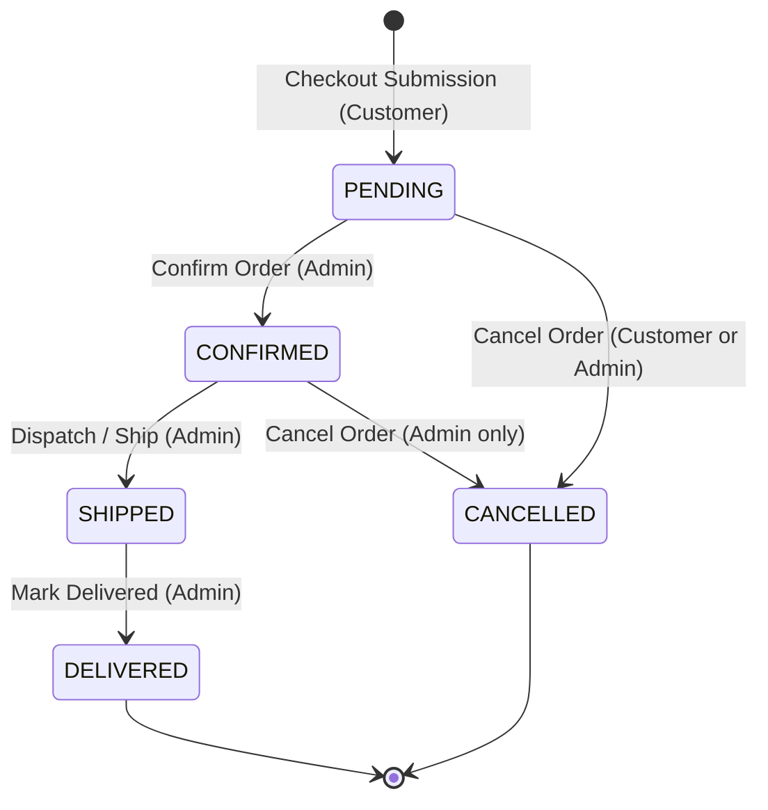
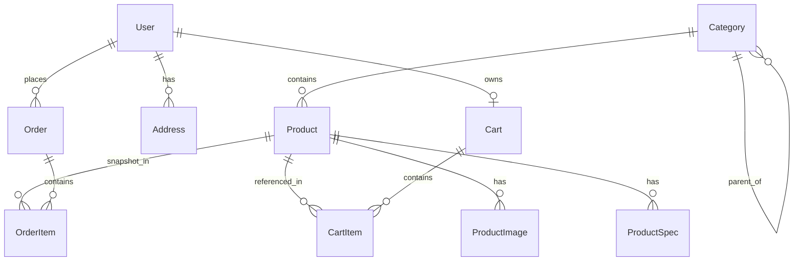

# Outdoor E-commerce Platform — System Requirements Specification

## 1. Executive Overview and Scope Baseline

This document defines the comprehensive product, functional, non-functional, and data requirements for the **Outdoor E-commerce Platform**. It operationalizes the charter established in [`PROJECT_BRIEF.md`](file:///d:/A-creat%20skills-/outdoor-ecommerce/PROJECT_BRIEF.md) into concrete, verifiable specifications in accordance with [`PROJECT_WORKFLOW.md`](file:///d:/A-creat%20skills-/PROJECT_WORKFLOW.md) Phase 01 requirements and [Senior Frontend Engineering — Global Rules](file:///C:/Users/Rezvan/.gemini/GEMINI.md).

### 1.1 Scope Boundaries & Core Guarantees
* **Demonstration Platform:** The application is a full-stack demonstration e-commerce store with persistent data for camping gear and outdoor equipment.
* **Cardless Simulated Checkout:** No real payment processing, payment gateway integration (Stripe, PayPal), or real credit card collection. Checkout uses an explicit simulated confirmation flow without collecting, transmitting, or storing payment-card data.
* **Server-Enforced Authorization:** Administrative mutations (catalog management, stock adjustment, order status transitions) are strictly guarded at the server/API layer.
* **Persistent Data Invariants:** Products, users, carts, and orders are backed by a persistent data store across process restarts.

---

## 2. User Personas and Core User Journeys

### 2.1 Personas
1. **Outdoor Enthusiast / Shopper (Customer):** Browses categories, uses keyword search and faceted filters, inspects technical specs on Product Detail Pages (PDP), manages a persistent shopping cart (as guest or authenticated user), checks out via simulated confirmation, and tracks order history.
2. **Store Administrator (Admin):** Authenticates with elevated credentials, accesses protected administrative views, manages product catalog and stock levels, reviews orders, and updates order fulfillment statuses.

### 2.2 Core User Journeys
* **`UJ-01` (Product Discovery & Search):** Customer visits storefront $\rightarrow$ browses category taxonomy $\rightarrow$ applies faceted filters (price range, stock status, rating) and search keywords $\rightarrow$ sorts results $\rightarrow$ selects product to open PDP.
* **`UJ-02` (Cart Management & Guest Persistence):** Unauthenticated guest adds product to cart $\rightarrow$ adjusts line item quantities $\rightarrow$ cart persists across browser sessions via client storage / session cookie $\rightarrow$ guest reviews dynamic subtotal, provisional tax, and shipping calculation.
* **`UJ-03` (Guest Cart Reconciliation on Login):** Guest with local cart items navigates to login/register $\rightarrow$ authenticates successfully $\rightarrow$ guest cart deterministically merges into database-backed user cart with duplicate summation and stock clamping $\rightarrow$ guest client storage is cleared.
* **`UJ-04` (Cardless Simulated Checkout):** Authenticated customer clicks "Proceed to Checkout" $\rightarrow$ enters/selects shipping address $\rightarrow$ selects shipping tier (Standard vs. Express) $\rightarrow$ reviews order summary with demonstration disclaimer $\rightarrow$ clicks "Confirm Demo Order" $\rightarrow$ receives unique order confirmation receipt (`ORD-YYYY-XXXXX`) in `PENDING` status.
* **`UJ-05` (Customer Order History & Self-Cancellation):** Customer views account profile $\rightarrow$ inspects chronological order list $\rightarrow$ opens itemized order view $\rightarrow$ if order status is `PENDING`, customer can trigger order cancellation $\rightarrow$ order transitions to `CANCELLED` and inventory is atomically restored.
* **`UJ-06` (Admin Catalog & Inventory Oversight):** Admin authenticates $\rightarrow$ accesses `/admin` $\rightarrow$ reviews paginated product inventory $\rightarrow$ updates price and stock quantities $\rightarrow$ changes are immediately reflected on storefront.
* **`UJ-07` (Admin Order Lifecycle Management):** Admin inspects customer order queue $\rightarrow$ filters by status $\rightarrow$ verifies order details $\rightarrow$ transitions order from `PENDING` to `CONFIRMED` $\rightarrow$ subsequently transitions order to `SHIPPED` $\rightarrow$ finally marks order `DELIVERED`.

---

## 3. Functional Requirements (FR)

### 3.1 FR-CAT: Product Catalog and Taxonomy
* **`FR-CAT-01` (Taxonomy):** The catalog shall organize products under four primary categories:
  1. `tents-shelters`: Backpacking tents, 4-season expedition shelters, ultralight tarps, and footprints.
  2. `backpacks-packs`: Multi-day expedition packs, technical daypacks, and hydration packs.
  3. `camp-kitchen`: Canister/liquid stoves, titanium cookware, mess kits, and water filtration systems.
  4. `outdoor-apparel`: Weatherproof technical shells, insulated jackets, hiking boots, and thermal base layers.
* **`FR-CAT-02` (Product Attributes):** Each product shall have: `id`, `sku`, `title`, `slug`, `categoryId`, `description`, `price`, `salePrice` (nullable), `stockQuantity`, `rating` (demo score), `reviewCount`, `isFeatured` (boolean), `specifications` (key-value pairs), and `images`.
* **`FR-CAT-03` (Inventory Badges):**
  * If `stockQuantity > 3`: Display "In Stock" indicator.
  * If `1 <= stockQuantity <= 3`: Display prominent "Low Stock — Only X left!" warning badge.
  * If `stockQuantity == 0`: Display "Out of Stock" badge and disable add-to-cart actions.

### 3.2 FR-SRCH: Discovery, Search, and Filtering
* **`FR-SRCH-01` (Keyword Search):** Case-insensitive matching across product titles, descriptions, categories, and technical tags.
* **`FR-SRCH-02` (Faceted Filtering):**
  * Category filter (single or multi-select).
  * Price range filter (min/max boundaries).
  * In-Stock Only filter (excludes `stockQuantity == 0`).
  * Rating filter ($\ge 4$ stars, $\ge 3$ stars).
* **`FR-SRCH-03` (Sorting):** Sort by Featured (default), Price: Low to High, Price: High to Low, Rating: High to Low, and Newest.
* **`FR-SRCH-04` (Empty Search State):** When no products match query/filters, display an informative empty state with a "Reset Filters" action.

### 3.3 FR-PDP: Product Detail Page
* **`FR-PDP-01` (Visual Presentation):** High-resolution product imagery with semantic `alt` attributes, image thumbnail selector, and primary image view.
* **`FR-PDP-02` (Pricing Display):** Clear presentation of current price. If `salePrice` is present, display original price with visual strikethrough alongside the discounted price.
* **`FR-PDP-03` (Quantity Selector):** Input clamped between $1$ and $\min(10, \text{stockQuantity})$. Disabled if `stockQuantity == 0`.
* **`FR-PDP-04` (Technical Specs Table):** Structured display of technical attributes (e.g., Weight, Dimensions, Capacity, Temperature Rating, Material).
* **`FR-PDP-05` (Demonstration Reviews):** Display sample customer reviews with prominent label: *"Demonstration product rating and sample reviews"*.
* **`FR-PDP-06` (Related Products):** Display grid/carousel of related items belonging to the same category.

### 3.4 FR-AUTH: Authentication and Accounts
* **`FR-AUTH-01` (Registration):** Collects Full Name, Email, Password, and Password Confirmation. Validates RFC 5322 email syntax and minimum 8-character password length. Rejects duplicate emails with a clear error.
* **`FR-AUTH-02` (Authentication):** Email and password authentication against salted password hashes. Rejects invalid credentials with a generic message: *"Invalid email or password"*.
* **`FR-AUTH-03` (Session Persistence):** Authenticated session persisted via secure HTTP cookies.
* **`FR-AUTH-04` (Role Assignment):** Default role is `CUSTOMER`. Dedicated seed accounts are assigned `ADMIN`.
* **`FR-AUTH-05` (Sign-Out):** Clears session tokens and terminates the active authenticated session.

### 3.5 FR-CART: Shopping Cart & Guest Reconciliation
* **`FR-CART-01` (Guest Cart):** Unauthenticated users can add products to a cart stored in client storage / session cookies.
* **`FR-CART-02` (Cart Controls):** Users can increment/decrement line item quantities, remove individual items, or empty the cart.
* **`FR-CART-03` (Dynamic Pricing Breakdown):**
  * Subtotal: $\sum (\text{unitPrice} \times \text{quantity})$.
  * Provisional Tax: Flat $8.0\%$ of subtotal.
  * Provisional Shipping: $5.00$ standard (waived if subtotal $\ge \$75.00$); $15.00$ express.
  * Total: $\text{Subtotal} + \text{Tax} + \text{Shipping}$.
* **`FR-CART-04` (Guest Reconciliation Rules):** Upon sign-in, guest items merge into user database cart deterministically:
  1. *Unique items:* Appended directly to database cart.
  2. *Duplicate items:* Quantities summed: $Q_{merged} = Q_{guest} + Q_{user}$.
  3. *Stock Clamping:* If $Q_{merged} > \text{StockQuantity}$, quantity is clamped to $\text{StockQuantity}$, and user receives notification: *"Item quantity was adjusted to the maximum available stock."*
  4. *Out-of-Stock Items:* Items with $0$ stock are flagged and moved to an inactive cart section.
  5. *Storage Cleanup:* Guest storage is cleared upon successful reconciliation.

### 3.6 FR-CHK: Cardless Simulated Checkout
* **`FR-CHK-01` (Authentication Prerequisite):** Checkout requires authenticated context. Unauthenticated users are redirected to login/register with checkout redirect retention.
* **`FR-CHK-02` (Step 1 — Shipping Address):** Captures Full Name, Street Address, City, State/Province, Postal Code, Country, and Contact Phone.
* **`FR-CHK-03` (Step 2 — Shipping Tier):** Selection between Standard ($5.00 / Free $\ge \$75$) and Express ($15.00).
* **`FR-CHK-04` (Step 3 — Simulated Payment):** Displays itemized order review, selected shipping method, and a simulated payment selector (e.g. "Simulated Credit Card / Demo Payment"). Prominently displays: *"DEMO PLATFORM: No real payment will be charged. Do not enter real credit card numbers."* No card number, CVV, or expiration fields are collected or stored.
* **`FR-CHK-05` (Step 4 — Atomic Order Creation):** Submitting checkout executes an atomic transaction that:
  1. Validates available inventory for all line items.
  2. Decrements `stockQuantity` atomically for each line item.
  3. Creates an immutable `Order` in `PENDING` status with an `idempotencyKey` and frozen `OrderItem` price/name snapshots.
  4. Clears active user cart.
* **`FR-CHK-06` (Stock Conflict on Checkout):** If an item is exhausted concurrently before checkout completes, the transaction rolls back, no order is placed, and the user receives **HTTP 409 Conflict** with an actionable stock message.

### 3.7 FR-ORD: Customer Order Management
* **`FR-ORD-01` (Order History):** Customer account dashboard lists past orders in reverse chronological order.
* **`FR-ORD-02` (Itemized Receipt):** Detailed view displaying order number, placement timestamp, current status, shipping address, line items with frozen purchase prices, and totals.
* **`FR-ORD-03` (Customer Cancellation):** Customer can cancel an order if and only if its status is `PENDING`. Cancelling atomically restores line item quantities to inventory and transitions status to `CANCELLED`.
* **`FR-ORD-04` (Cancellation Lock):** If status has transitioned to `CONFIRMED`, `SHIPPED`, or `DELIVERED`, customer cancellation action is disabled and returns **HTTP 403 Forbidden** / **HTTP 409 Conflict** if requested directly.

### 3.8 FR-ADM: Protected Administrator Operations
* **`FR-ADM-01` (Route Protection):** `/admin` routes and administrative API endpoints require `ADMIN` role. Unauthenticated requests return **HTTP 401 Unauthorized**; non-admin users return **HTTP 403 Forbidden**.
* **`FR-ADM-02` (Product Inventory Management):** Admin can create new products, edit titles, descriptions, prices, specifications, and update stock counts.
* **`FR-ADM-03` (Order Queue Oversight):** Admin can view all platform orders, filter by status (`PENDING`, `CONFIRMED`, `SHIPPED`, `DELIVERED`, `CANCELLED`), and inspect customer details.
* **`FR-ADM-04` (Controlled State Transitions):** Admin can advance order status according to the strict state machine. Admin cancellation of `PENDING` or `CONFIRMED` orders atomically restores stock. Dispatched (`SHIPPED`) or completed (`DELIVERED`) orders cannot be cancelled.

---

## 4. Seed Product Catalog Specification

The demonstration catalog consists of 14 realistic outdoor products across the four primary categories, modeling all specified inventory states:

| # | Category | Product Title | SKU | Price | Sale Price | Stock | Stock State | Key Specs |
| :-: | :--- | :--- | :--- | :-: | :-: | :-: | :---: | :--- |
| 1 | `tents-shelters` | Summit Ridge 2-Person Backpacking Tent | `TNT-SR2-001` | $289.99 | $249.99 | 14 | In-Stock | 2-person, 3-season, 4.2 lbs, 68D Polyester |
| 2 | `tents-shelters` | Alpine Fortress 4-Season Expedition Tent | `TNT-AF4-002` | $599.99 | — | 3 | **Low-Stock** | 4-person, 4-season, 9.8 lbs, Geodesic aluminum |
| 3 | `tents-shelters` | Ultralight Silnylon Bivy Shelter | `TNT-ULB-003` | $119.99 | — | 0 | **Out-of-Stock** | 1-person, 1.1 lbs, 20D Silnylon, 3000mm coating |
| 4 | `tents-shelters` | Trailside Waterproof Hex Tarp | `TNT-HEX-004` | $79.99 | $64.99 | 22 | In-Stock | 12x10 ft, 1.8 lbs, 210T Ripstop, Reinforced tie-outs |
| 5 | `backpacks-packs` | Traverse Pro 65L Expedition Pack | `BPK-TP65-001` | $329.99 | — | 2 | **Low-Stock** | 65L capacity, 4.6 lbs, Adjustable torso, Raincover |
| 6 | `backpacks-packs` | Skyline 30L Daypack & Hydration Rig | `BPK-SK30-002` | $129.99 | $99.99 | 18 | In-Stock | 30L capacity, 2.1 lbs, 2.5L reservoir included |
| 7 | `backpacks-packs` | RidgeRunner Ultralight 45L Fastpack | `BPK-RR45-003` | $219.99 | — | 8 | In-Stock | 45L capacity, 2.3 lbs, Roll-top, Dyneema composite |
| 8 | `backpacks-packs` | PeakSummit Hydration Lumbar Pack | `BPK-PS10-004` | $69.99 | — | 0 | **Out-of-Stock** | 10L capacity, 1.2 lbs, 1.5L bladder, Lumbar harness |
| 9 | `camp-kitchen` | Backcountry Micro Canister Stove | `KIT-BMS-001` | $49.99 | — | 25 | In-Stock | 2.6 oz, 10,000 BTU, Piezo igniter, Isobutane |
| 10 | `camp-kitchen` | Titanium 2-Pot Ultralight Cookset | `KIT-TP2-002` | $89.99 | $74.99 | 1 | **Low-Stock** | 800ml + 500ml pots, 7.4 oz, Titanium, Folding handles |
| 11 | `camp-kitchen` | GravityFlow Backcountry Water Filter | `KIT-GFW-003` | $64.99 | — | 16 | In-Stock | 0.1 micron hollow fiber, 4L capacity, 1.5L/min |
| 12 | `camp-kitchen` | Portable Windproof Camp Stove | `KIT-PWS-004` | $39.99 | — | 0 | **Out-of-Stock** | 11.2 oz, Built-in wind baffles, Brass valve |
| 13 | `outdoor-apparel` | StormShield 3-Layer GORE-TEX Shell | `APP-SS3-001` | $389.99 | $329.99 | 6 | In-Stock | 3L Waterproof/Breathable, Pit zips, Helmet hood |
| 14 | `outdoor-apparel` | ThermalLoft 800-Fill Down Jacket | `APP-TLD-002` | $259.99 | — | 2 | **Low-Stock** | 800-fill goose down, 13 oz, DWR treated, Packable |

---

## 5. Order Lifecycle State Machine and Transition Invariants

### 5.1 Mermaid State Diagram



### 5.2 Transition Invariants & HTTP Error Semantics

| Source State | Target State | Authorized Actor | Invariants & Business Logic | Error on Invalid Attempt |
| :--- | :--- | :--- | :--- | :--- |
| **New Cart** | `PENDING` | Customer / System | Checkout submission, atomic stock deduction, unique `idempotencyKey` check. | **HTTP 409 Conflict** (stock conflict) / **HTTP 400 Bad Request** |
| `PENDING` | `CONFIRMED` | Administrator | Admin verification of inventory and order details. | **HTTP 401 Unauthorized** / **HTTP 403 Forbidden** |
| `PENDING` | `CANCELLED` | Customer (owner) or Admin | Order is currently in `PENDING`. Atomically restores decremented line item quantities to inventory. | **HTTP 409 Conflict** (if state has changed) |
| `CONFIRMED` | `SHIPPED` | Administrator | Order is in `CONFIRMED`. Tracking reference recorded (demo string). Customer cancellation locked. | **HTTP 409 Conflict** |
| `CONFIRMED` | `CANCELLED` | Administrator only | Pre-dispatch cancellation. Atomically restores decremented line item quantities to inventory. | **HTTP 403 Forbidden** (if customer) / **HTTP 409 Conflict** |
| `SHIPPED` | `DELIVERED` | Administrator only | Delivery receipt confirmation. | **HTTP 409 Conflict** |
| `SHIPPED` | `CANCELLED` | *Prohibited* | **REJECTED:** Dispatched orders cannot be cancelled directly. | **HTTP 409 Conflict** |
| `DELIVERED` | *Any State* | *Prohibited* | **REJECTED:** Delivered orders are in a terminal state. | **HTTP 409 Conflict** |
| `CANCELLED` | *Any State* | *Prohibited* | **REJECTED:** Cancelled orders are in a terminal state. | **HTTP 409 Conflict** |

---

## 6. Preliminary Domain Entity Model

> [!NOTE]
> The entities below represent a preliminary conceptual domain model for requirements capture. Storage-specific schema details, migrations, ORM bindings, and database engine selection are explicitly deferred to **Phase 03 (Technical Planning & Architecture)**.



### Entity Attribute Definitions
1. **`User`:** `id`, `email`, `passwordHash`, `name`, `role` (`CUSTOMER` | `ADMIN`), `createdAt`, `updatedAt`.
2. **`Address`:** `id`, `userId`, `fullName`, `street`, `city`, `state`, `postalCode`, `country`, `phone`, `isDefault`.
3. **`Category`:** `id`, `name`, `slug`, `description`, `imageUrl`, `displayOrder`.
4. **`Product`:** `id`, `categoryId`, `title`, `slug`, `sku`, `description`, `price`, `salePrice`, `stockQuantity`, `rating`, `reviewCount`, `isFeatured`, `createdAt`, `updatedAt`.
5. **`ProductImage`:** `id`, `productId`, `url`, `altText`, `displayOrder`, `isPrimary`.
6. **`ProductSpec`:** `id`, `productId`, `specKey`, `specValue`, `displayOrder`.
7. **`Cart`:** `id`, `userId` (nullable), `sessionToken` (for guest carts), `createdAt`, `updatedAt`.
8. **`CartItem`:** `id`, `cartId`, `productId`, `quantity`, `createdAt`, `updatedAt`.
9. **`Order`:** `id`, `orderNumber`, `idempotencyKey`, `userId`, `customerName`, `customerEmail`, `shippingAddressJson`, `shippingTier`, `subtotal`, `shippingCost`, `tax`, `total`, `status` (`PENDING` | `CONFIRMED` | `SHIPPED` | `DELIVERED` | `CANCELLED`), `createdAt`, `updatedAt`.
10. **`OrderItem`:** `id`, `orderId`, `productId`, `productTitle`, `productSku`, `unitPrice`, `quantity`, `subtotal`.

---

## 7. Inventory Consistency, Atomicity, and Idempotency

### 7.1 Atomic Checkout Decrement & Rollback
* When an authenticated customer submits checkout, the server executes an atomic database transaction:
  1. Verifies that every line item has $\text{stockQuantity} \ge \text{requestedQuantity}$.
  2. If any item has insufficient stock, the transaction **aborts immediately**, no records are inserted, inventory remains unchanged, and the server returns **HTTP 409 Conflict** with:
     ```json
     {
       "error": "INSUFFICIENT_STOCK",
       "productId": "BPK-TP65-001",
       "message": "Only 2 units of 'Traverse Pro 65L Expedition Pack' remain in stock."
     }
     ```
  3. If all items are available, stock is decremented: $\text{stockQuantity}_{new} = \text{stockQuantity}_{current} - \text{quantity}$.
  4. The `Order` and `OrderItem` records are created, user cart is emptied, and transaction commits.

### 7.2 Idempotent Order Placement
* Checkout requests must include a client-generated `idempotencyKey` (UUIDv4).
* If a duplicate request with an identical `idempotencyKey` arrives (e.g. from network retry or rapid button double-clicks), the server detects the existing order and returns the existing order confirmation without re-executing inventory deductions or duplicating records.

### 7.3 Atomic Cancellation & Restoration
* When an eligible cancellation request is executed:
  1. The order status is verified to be in `PENDING` (or `CONFIRMED` if admin).
  2. The server transitions status to `CANCELLED`.
  3. Each `OrderItem` quantity is atomically incremented back into product inventory: $\text{stockQuantity}_{restored} = \text{stockQuantity} + \text{quantity}$.
* Subsequent cancellation requests for an already `CANCELLED` order are idempotent: the server returns success (or **HTTP 409 Conflict**) and does not restore inventory a second time.

---

## 8. Non-Functional Requirements (NFR)

* **`NFR-SEC-01` (Server-Enforced RBAC):** Server-side middleware validates every API route and server mutation. Unauthenticated requests to protected routes return **HTTP 401 Unauthorized**. Authenticated requests lacking the `ADMIN` role attempting `/admin` operations return **HTTP 403 Forbidden**.
* **`NFR-SEC-02` (Password Security):** Passwords hashed using industry-standard salted hashing algorithms (bcrypt/Argon2). No plaintext passwords logged or persisted.
* **`NFR-SEC-03` (Payment Privacy & Mock Boundary):** Absolute zero collection, storage, or transmission of real credit card numbers, CVVs, expiration dates, or bank account credentials.
* **`NFR-A11Y-01` (WCAG 2.2 Level AA Accessibility):**
  * Keyboard navigation: All interactive controls (drawers, modal dialogs, category accordions, quantity steppers) must be accessible via Tab/Shift+Tab and Enter/Space with visible focus indicators.
  * Form accessibility: Explicit `<label>` associations, clear error announcements with `aria-describedby`, and accessible names for all icon buttons.
  * Contrast: Minimum $4.5:1$ contrast ratio for body copy and $3:1$ for large text and UI boundaries.
* **`NFR-RESP-01` (Responsive Integrity):** Fluid layouts from 320px mobile to 1440px+ desktop. No horizontal scrolling or clipped text. Touch targets minimum $44 \times 44$px on touch viewports.
* **`NFR-PERF-01` (Performance & CLS Prevention):** Explicit width/height aspect-ratio containers on all product image wrappers to prevent Cumulative Layout Shift (CLS). Indexed database search fields on categories, SKU, and order numbers.
* **`NFR-SEO-01` (Semantic Structure):** Single `h1` per page, hierarchical `h2`/`h3` outline, meta descriptions, and schema.org `Product` structured data.

---

## 9. Provisional Demonstration Pricing Rules

> [!NOTE]
> The values below are provisional demonstration rules established for consistent demonstration calculations. They are not representations of actual commercial or tax obligations. Their implementation and configuration mechanics belong to the design/architecture phases.

1. **Illustrative Sales Tax:** A flat **8.0%** rate calculated on order subtotal:
   $$\text{Tax} = \text{round}(\text{Subtotal} \times 0.08, 2)$$
2. **Provisional Shipping Rates:**
   * **Standard Shipping:** Flat $5.00$ rate. Automatically waived (**Free**) for orders with subtotal $\ge \$75.00$.
   * **Express Shipping:** Flat $15.00$ rate regardless of order subtotal.

---

## 10. Verifiable Acceptance Criteria Matrix (Gherkin Scenarios)

### Scenario 1: Guest Cart Merge on Authentication with Stock Clamping
* **Given** a guest user has added 3 units of "Alpine Fortress 4-Season Tent" (Stock: 3) to their browser guest cart,
* **And** the customer logs into an existing account that already has 1 unit of "Alpine Fortress 4-Season Tent" in its database cart,
* **When** the authentication and reconciliation process completes,
* **Then** the database cart contains a single line item for "Alpine Fortress 4-Season Tent" with quantity clamped to 3,
* **And** the customer receives an informational notification: *"Item quantity was adjusted to the maximum available stock."*,
* **And** the browser's guest cart storage is purged.

### Scenario 2: Atomic Stock Decrement on Successful Checkout
* **Given** a product "Traverse Pro 65L Expedition Pack" has an available stock quantity of 2,
* **And** an authenticated customer completes simulated checkout for 1 unit,
* **When** the order submission is confirmed,
* **Then** an `Order` record is generated in `PENDING` status,
* **And** the product's `stockQuantity` is atomically decremented to 1,
* **And** the customer's active shopping cart is cleared.

### Scenario 3: Stock Conflict Rollback on Concurrent Purchase
* **Given** a product "Titanium 2-Pot Cookset" has an available stock quantity of 1,
* **And** two customers (User A and User B) attempt to submit checkout for 1 unit at the same time,
* **When** User A's transaction commits first,
* **Then** User A's order is created in `PENDING` status with stock decremented to 0,
* **And** User B's checkout transaction is rejected with **HTTP 409 Conflict**,
* **And** no order is placed for User B, and inventory remains accurately at 0.

### Scenario 4: Idempotent Order Cancellation & Stock Restoration
* **Given** an order `ORD-2026-00101` currently in `PENDING` status containing 2 units of "Backcountry Micro Stove",
* **When** the customer submits a cancellation request,
* **Then** the server transitions the order status to `CANCELLED`,
* **And** 2 units of "Backcountry Micro Stove" are restored to product inventory in an atomic transaction,
* **When** the customer submits an identical cancellation request again,
* **Then** the server responds idempotently with **HTTP 200 OK** (or **HTTP 409 Conflict**),
* **And** product inventory is not incremented a second time.

### Scenario 5: Rejection of Customer Cancellation for Confirmed Order
* **Given** an order `ORD-2026-00102` currently in `CONFIRMED` status,
* **When** the customer attempts to cancel `ORD-2026-00102`,
* **Then** the server rejects the request with **HTTP 403 Forbidden** (or **HTTP 409 Conflict**),
* **And** the order status remains `CONFIRMED`,
* **And** inventory is not modified.

### Scenario 6: Rejection of Invalid State Transition for Shipped Order
* **Given** an order `ORD-2026-00103` currently in `SHIPPED` status,
* **When** an administrator attempts to change status directly to `CANCELLED`,
* **Then** the server rejects the transition with **HTTP 409 Conflict**,
* **And** an error message indicates that dispatched orders cannot be cancelled directly,
* **And** the order status remains `SHIPPED`.

### Scenario 7: Server-Enforced RBAC on Administrative Mutation
* **Given** a request sent by a user authenticated with the `CUSTOMER` role,
* **When** the request attempts to execute a `POST` or `PUT` to an administrative product endpoint (e.g. `/api/admin/products`),
* **Then** the server rejects the request with **HTTP 403 Forbidden**,
* **And** no catalog or database changes occur.

---

## 11. Traceability Matrix

| Requirement Area | Source Requirement | Document Section Reference | Acceptance Criteria Scenario |
| :--- | :--- | :--- | :--- |
| **Catalog & Taxonomy** | [`PROJECT_BRIEF.md`](file:///d:/A-creat%20skills-/outdoor-ecommerce/PROJECT_BRIEF.md) §3.1 | §3.1 (`FR-CAT-01` to `FR-CAT-03`), §4 | Verified via Seed Catalog Table |
| **Search & Discovery** | [`PROJECT_BRIEF.md`](file:///d:/A-creat%20skills-/outdoor-ecommerce/PROJECT_BRIEF.md) §3.1 | §3.2 (`FR-SRCH-01` to `FR-SRCH-04`) | Tested via query & faceted filter scenarios |
| **PDP Presentation** | [`PROJECT_BRIEF.md`](file:///d:/A-creat%20skills-/outdoor-ecommerce/PROJECT_BRIEF.md) §3.1 | §3.3 (`FR-PDP-01` to `FR-PDP-06`) | Verified via Stock State UI Badges |
| **Authentication & RBAC**| [`PROJECT_BRIEF.md`](file:///d:/A-creat%20skills-/outdoor-ecommerce/PROJECT_BRIEF.md) §3.2, §4 | §3.4 (`FR-AUTH-01` to `05`), §8 (`NFR-SEC-01`) | Scenario 7 |
| **Cart & Guest Merge** | [`PROJECT_BRIEF.md`](file:///d:/A-creat%20skills-/outdoor-ecommerce/PROJECT_BRIEF.md) §3.3 | §3.5 (`FR-CART-01` to `04`) | Scenario 1 |
| **Simulated Checkout** | [`PROJECT_BRIEF.md`](file:///d:/A-creat%20skills-/outdoor-ecommerce/PROJECT_BRIEF.md) §3.4, §4 | §3.6 (`FR-CHK-01` to `06`), §7.1 | Scenario 2, Scenario 3 |
| **Order Management** | [`PROJECT_BRIEF.md`](file:///d:/A-creat%20skills-/outdoor-ecommerce/PROJECT_BRIEF.md) §3.4 | §3.7 (`FR-ORD-01` to `04`), §5 | Scenario 4, Scenario 5 |
| **Admin Operations** | [`PROJECT_BRIEF.md`](file:///d:/A-creat%20skills-/outdoor-ecommerce/PROJECT_BRIEF.md) §3.5 | §3.8 (`FR-ADM-01` to `04`), §5 | Scenario 6, Scenario 7 |
| **Atomic Inventory** | Approved Decision DEC-010 | §7.1, §7.2, §7.3 | Scenario 2, Scenario 3, Scenario 4 |
| **Order State Machine** | Approved Decision DEC-007 | §5.1, §5.2 | Scenario 4, Scenario 5, Scenario 6 |
